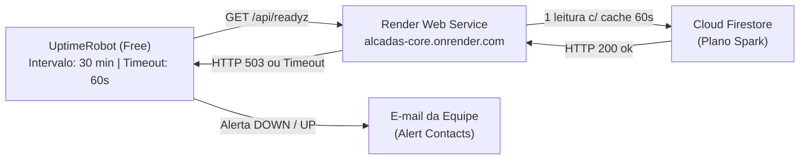

# Monitoramento Externo com UptimeRobot & Runbook de Rollback (Issue #53)

Este documento detalha a configuração do **monitoramento externo de disponibilidade** da API em produção, a análise **FinOps** para respeitar os limites gratuitos do Render e do Firebase Spark, o roteiro de comprovação de alertas e o runbook completo de **rollback**, em atendimento à **[Issue #53](https://github.com/Alcadas/alcadas-core/issues/53)**, ao **[Épico #42](https://github.com/Alcadas/alcadas-core/issues/42)**, à Issue **#54** e à **ADR-011 (Plano Custo Zero)**.

---

## 1. Arquitetura do Monitoramento Externo



### Por que monitorar `/api/readyz` e não `/api/healthz`?
- **`/api/healthz` (Liveness):** Verifica apenas se o processo Node.js/Express está respondendo. É usado internamente pelo Render para checar o boot do contêiner, sem consultar o banco de dados.
- **`/api/readyz` (Readiness):** Valida que a API está viva **e** que a comunicação com o Cloud Firestore real via Firebase Admin SDK está operacional (`HTTP 200 {"status":"ok","firestore":"ok"}`). Caso o Firestore fique inacessível ou a credencial expire, o endpoint responde **`HTTP 503`** e o UptimeRobot dispara o alerta imediatamente.

---

## 2. Configuração Passo a Passo no UptimeRobot

1. Acesse [https://uptimerobot.com/](https://uptimerobot.com/) e faça login na conta da equipe (plano **Free** — até 50 monitores gratuitos, sem cartão de crédito).
2. No menu lateral, vá em **Integrations & API** (ou **My Settings → Alert Contacts**) e cadastre os e-mails dos responsáveis pela operação (ex.: DevOps e Tech Lead), confirmando o link de ativação enviado por e-mail.
3. No painel principal (**Monitoring**), clique em **+ Add New Monitor** e preencha:

| Campo | Valor Recomendado | Justificativa |
| :--- | :--- | :--- |
| **Monitor Type** | `HTTP(s)` | Verificação de status HTTP (2xx = UP; 4xx/5xx/timeout = DOWN) |
| **Friendly Name** | `Alçadas API — Produção (/api/readyz)` | Identificação clara nos e-mails de alerta |
| **URL (or IP)** | `https://alcadas-core.onrender.com/api/readyz` | Endpoint oficial de readiness da API em produção |
| **Monitoring Interval** | **`30 minutes`** *(ou `60 minutes` para economia máxima)* | Permite *spin-down* do Render entre checagens, mantendo consumo muito abaixo das 750h/mês |
| **Monitor Timeout** | **`60 seconds`** | Absorve eventuais *cold starts* (30–50s) do Render Free sem gerar falsos alertas |
| **Alert Contacts to Notify** | Selecionar todos os e-mails da equipe | Disparo automático em eventos `DOWN` e `UP` |

4. Clique em **Create Monitor** e verifique se o status inicial aparece como **Up (HTTP 200)**.

> **Alternativa equivalente (Custo Zero):** Caso a equipe deseje comparar ou manter redundância futura, o **Pulsetic** também oferece plano gratuito com monitoramento HTTP e alertas por e-mail.

---

## 3. Análise FinOps — Limite de 750h do Render e Cotas do Firestore (ADR-011)

O plano gratuito do **Render** oferece **750 horas mensais** compartilhadas entre todos os Web Services gratuitos da conta, hibernando instâncias inativas (*spin-down*) após **15 minutos** sem requisições. Já o **Firestore Spark** oferece **50.000 leituras/dia** gratuitas.

| Intervalo no UptimeRobot | Comportamento no Render Free | Consumo Estimado no Render (mês de 31 dias) | Margem na Franquia (750h/mês) | Leituras/dia no Firestore (`/readyz`) |
| :--- | :--- | :---: | :---: | :---: |
| `5 minutos` | Mantém instância sempre acordada (sem *spin-down*) | ~744 horas/mês | ~6h *(estoura se houver 2º serviço)* | 288 leituras/dia (0,57%) |
| **`30 minutos` (Adotado)** | Permite *spin-down* após 15 min em cada ciclo | **~384 horas/mês** | **~366h de folga** | **48 leituras/dia (< 0,1%)** |
| `60 minutos` (Conservador) | Permite *spin-down* após 15 min por hora | ~192 horas/mês | ~558h de folga | 24 leituras/dia (< 0,05%) |

### Por que adotamos o intervalo de 30 minutos?
1. **Segurança contra suspensão da conta Render:** Mesmo que um segundo serviço de testes ou homologação seja criado na mesma conta Render, o consumo de ~384h/mês deixa quase metade da cota gratuita disponível.
2. **Impacto desprezível no Firestore:** Apenas 48 leituras/dia (e protegidas pelo cache `READYZ_CACHE_TTL_MS=60000` de 60 segundos na API).
3. **Detecção confiável sem falsos positivos:** Combinado com timeout de **60 segundos**, o monitor aguarda o despertar (*cold start*) do contêiner no Render e alerta de forma precisa em indisponibilidades reais.

---

## 4. Roteiro Seguro para Comprovar o Disparo de Alerta (Zero Impacto)

Para validar que os alertas por e-mail funcionam sem precisar derrubar o ambiente de produção:

1. No painel do UptimeRobot, clique em **+ Add New Monitor**.
2. Crie um monitor temporário com:
   - **Monitor Type:** `HTTP(s)`
   - **Friendly Name:** `Teste de Alerta — Alçadas (Remover após validação)`
   - **URL:** `https://alcadas-core.onrender.com/api/readyz-teste-falha` *(rota inexistente que retorna `HTTP 404`)*
   - **Monitoring Interval:** `5 minutes` *(apenas para agilizar o teste)*
   - **Alert Contacts:** selecionar o e-mail da equipe.
3. Aguarde a primeira checagem (até 5 minutos):
   - O painel do UptimeRobot marcará o monitor temporário como **Down (HTTP 404)**.
   - O e-mail cadastrado receberá a notificação **"Monitor is DOWN: Teste de Alerta — Alçadas"**.
4. Capture as evidências (print do painel + print do e-mail recebido) para registro na Issue #53 / PR.
5. **Exclua o monitor temporário** após a comprovação, mantendo ativo apenas o monitor oficial apontando para `/api/readyz` com intervalo de **30 minutos**.

---

## 5. Runbook Completo de Diagnóstico e Rollback

### 5.1. Triagem Rápida de Incidente

Antes de iniciar um rollback, confirme qual camada apresentou falha:

```bash
# 1. Verificar se o processo da API está respondendo (Liveness)
curl -i https://alcadas-core.onrender.com/api/healthz

# 2. Verificar conectividade da API com o Firestore (Readiness)
curl -i https://alcadas-core.onrender.com/api/readyz

# 3. Verificar se o frontend SPA está respondendo HTTP 200
curl -I https://alcadas-producao-f40ec.web.app/login
```

- Se a resposta da API retornar erro `5xx`, copie o cabeçalho **`X-Request-Id`** da resposta e filtre os logs no painel do Render (**Logs**) por esse identificador para localizar a causa raiz sem exposição de dados pessoais (`RNF09`).

---

### 5.2. Rollback do Frontend (Firebase Hosting)

#### Opção A — Via Firebase Console (Recomendada, < 1 minuto)
1. Acesse o [Firebase Console](https://console.firebase.google.com/) e abra o projeto **`alcadas-producao-f40ec`**.
2. No menu lateral, clique em **Criação (Build) → Hosting**.
3. Na aba principal do site `alcadas-producao-f40ec`, role até **Histórico de lançamentos (Release history)**.
4. Identifique a versão estável imediatamente anterior à publicação com defeito.
5. Clique no menu **`⋮`** à direita da versão escolhida e clique em **Reverter (Rollback)**.
6. Confirme a ação e valide acessando `https://alcadas-producao-f40ec.web.app` em aba anônima.

#### Opção B — Via CLI (`firebase-tools`)
Caso prefira reimplantar localmente a partir de um commit estável anterior do Git:
```bash
git checkout <SHA-ESTAVEL>
npm ci
npx nx build web --configuration=production
npx firebase-tools deploy --only hosting --project alcadas-producao-f40ec
```

---

### 5.3. Rollback do Backend (Render)

#### Opção A — Via Painel do Render (Imediata, 1 a 2 minutos)
1. Acesse o [Render Dashboard](https://dashboard.render.com/) e selecione o serviço **`alcadas-core`**.
2. Clique em **Events** (ou **Deploys**) no menu lateral.
3. Encontre o último deploy estável anterior à falha (marcado como **Deploy live / Succeeded**).
4. Clique em **Rollback to this deploy** e confirme.
5. Aguarde o container reiniciar com a imagem anterior e confirme a recuperação:
   ```bash
   curl -i https://alcadas-core.onrender.com/api/readyz
   # Esperado: HTTP/2 200 {"status":"ok","firestore":"ok"}
   ```

---

### 5.4. Sincronização Pós-Rollback no Git (Obrigatória)

Rollbacks feitos diretamente no console do Firebase ou no painel do Render restauram o serviço imediatamente, mas não alteram a branch `main`. Para impedir que o próximo deploy automático reintroduza o código com defeito:

```bash
git checkout main
git pull origin main
git checkout -b fix/rollback-incidente
git revert <SHA-DO-COMMIT-COM-DEFEITO>
git push origin fix/rollback-incidente
```

Em seguida, abra um Pull Request direcionado à `main`, aguarde a aprovação de revisão e os checks verdes do CI para consolidar a reversão no histórico oficial.
