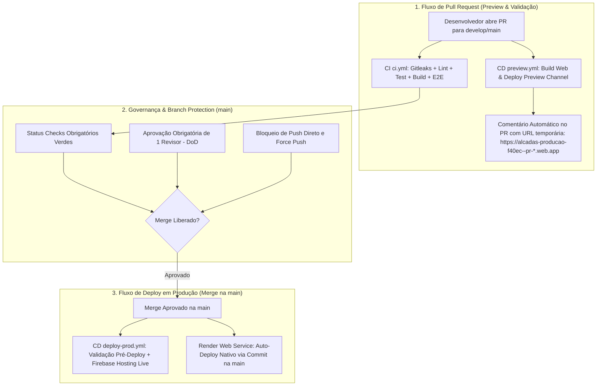

# Pipeline CI/CD com Canais de Preview, Deploy Contínuo e Proteção da Main (Issue #48)

Este documento estabelece a arquitetura operacional da esteira de **Integração Contínua (CI)** e **Entrega/Publicação Contínua (CD)** da plataforma Alçadas, atendendo à **[Issue #48](https://github.com/Alcadas/alcadas-core/issues/48)**, ao **[Épico #42](https://github.com/Alcadas/alcadas-core/issues/42)** (Infraestrutura Cloud & CI/CD Custo Zero), à **ADR-011** (Plano Custo Zero) e à **Definição de Pronto (DoD)** do projeto.

---

## 1. Visão Geral da Arquitetura de CI/CD

A esteira de entrega foi desenhada para garantir **rastreabilidade, qualidade estrita de código e governança de produção**, operando em regime de infraestrutura 100% gratuita (Spark / Free Tier) sem degradação operacional.



---

## 2. Canais de Preview Temporários no Firebase Hosting (`preview.yml`)

### 2.1. Como Funciona
Para todo Pull Request aberto ou atualizado com destino a `main` ou `develop`:
1. O workflow `.github/workflows/preview.yml` compila a aplicação Angular em modo de produção (`npx nx build web --configuration=production`).
2. Utiliza a GitHub Action oficial `FirebaseExtended/action-hosting-deploy@v0` para criar um **canal temporário isolado** identificado pelo número do PR:
   - Exemplo de URL gerada: `https://alcadas-producao-f40ec--pr-48-xpt0123.web.app`
3. A action publica um comentário dinâmico no Pull Request com o link de visualização e o status da publicação.
4. O canal possui validade estrita de **7 dias** (`expires: 7d`), garantindo limpeza automática de recursos e evitando o acúmulo de arquivos órfãos no plano Firebase Spark (FinOps / ADR-011).

### 2.2. Integração com CORS da API em Produção (Issue #34)
A API NestJS (`apps/api`) em execução no Render já possui o padrão regex de canais de preview configurado em `apps/api/src/app/common/cors.ts`:
```typescript
export function padraoCanaisDePreview(firebaseProjectId: string): RegExp {
  const sanitized = firebaseProjectId.replace(/[-/\\^$*+?.()|[\]{}]/g, '\\$&');
  return new RegExp(`^https:\\/\\/${sanitized}(?:--[a-z0-9-]+)?\\.web\\.app$`);
}
```
Como o `FIREBASE_PROJECT_ID` em produção é `alcadas-producao-f40ec`, qualquer canal de preview gerado pelo GitHub Actions (`https://alcadas-producao-f40ec--pr-*.web.app`) tem permissão de comunicação CORS autorizada com a API de produção (`https://alcadas-core.onrender.com/api`).

---

## 3. Deploy Automático em Produção (`deploy-prod.yml`)

### 3.1. Frontend (Firebase Hosting Canal `live`)
Quando um Pull Request é revisado, aprovado e mergeado na branch `main`:
1. O workflow `.github/workflows/deploy-prod.yml` é acionado pelo evento `push`.
2. **Job `ci-verification`**: Executa uma bateria completa de testes unitários (`nx run-many --target=test`) e compilação de todas as aplicações e bibliotecas (`nx run-many --target=build`).
3. **Job `deploy-frontend`**: Compila o frontend web e publica os artefatos compilados diretamente no canal principal de produção (`live`) do Firebase Hosting (`https://alcadas-producao-f40ec.web.app`).

### 3.2. Backend API (Render Web Service)
O Web Service da API no Render (`alcadas-api`) está conectado diretamente ao repositório GitHub e com **Auto-Deploy nativo ativado**:
- Ao receber um novo commit na branch `main`, o Render aguarda a conclusão com sucesso dos status checks do GitHub Actions.
- Uma vez verificados os checks obrigatórios, o Render realiza o build do container multi-stage Alpine não-root (`docker/Dockerfile.api.production`) e faz o deploy com zero downtime.
- Dessa forma, não é necessário manter nem disparar tokens manuais de Deploy Hook via GitHub Actions, simplificando a esteira e reduzindo a superfície de credenciais.

---

## 4. Regras de Proteção da Branch `main` (Branch Protection)

Em estrita conformidade com a **Definição de Pronto (DoD)** e práticas de engenharia de software seguras, a branch `main` possui as seguintes regras de proteção ativadas:

| Regra | Configuração | Finalidade |
| :--- | :--- | :--- |
| **Require Pull Request Reviews** | 1 aprovação obrigatória | Garante que nenhuma alteração chegue em produção sem revisão e aprovação formal de código. |
| **Dismiss Stale Reviews** | Ativado (`true`) | Se novos commits forem adicionados ao PR após uma aprovação, a aprovação anterior é invalidada, exigindo nova revisão. |
| **Require Status Checks to Pass** | Modo Estrito (`strict: true`) | A branch do PR deve estar perfeitamente sincronizada e atualizada com a `main` antes do merge ser permitido. |
| **Status Check Obrigatório 1** | `Varredura de Segredos (Gitleaks)` | Impede o merge de código caso qualquer segredo ou chave privada seja detectada no histórico de commits. |
| **Status Check Obrigatório 2** | `Validação de Código, Testes e Build` | Garante que testes unitários, testes de contrato/regras de negócio e compilação estejam 100% verdes. |
| **Block Force Pushes** | Bloqueado (`allow_force_pushes: false`) | Impede a sobrescrita destrutiva do histórico de commits da branch de produção. |
| **Block Deletions** | Bloqueado (`allow_deletions: false`) | Impede que a branch principal seja acidentalmente apagada. |
| **Enforce Admins** | Desativado (`false`) | Mantém a governança rigorosa, mas permite atuação de emergência do mantenedor em cenários excepcionais devidamente auditados. |

---

## 5. Configuração de Credenciais e Segredos no GitHub

Para habilitar a publicação automática no Firebase Hosting através do GitHub Actions:

### 5.1. Segredo `FIREBASE_SERVICE_ACCOUNT`
1. No console do Google Cloud / Firebase do projeto `alcadas-producao-f40ec`:
   - Gerar uma chave de Service Account com a permissão mínima de Hosting (`roles/firebasehosting.admin`).
   - Copiar o JSON completo da credencial.
2. No repositório GitHub (`https://github.com/Alcadas/alcadas-core`):
   - Acessar `Settings > Secrets and variables > Actions`.
   - Clicar em **New repository secret**.
   - **Name**: `FIREBASE_SERVICE_ACCOUNT` (ou `FIREBASE_SERVICE_ACCOUNT_ALCADAS_PRODUCAO_F40EC`).
   - **Secret**: Colar o JSON da conta de serviço.
3. Se o segredo não estiver configurado, os workflows emitem avisos (`::warning::`) sem falhar silenciosamente nem expor erros indecifráveis.

---

## 6. Histórico de Versões e Rastreabilidade

- **Issue #48**: Implementação da pipeline CI/CD com preview em PRs, deploy automático e proteção da main.
- **Issue #51**: Varredura contínua de segredos com Gitleaks e credencial de serviço de menor privilégio.
- **Issue #46**: Conteinerização multi-stage e deploy da API no Render.
- **Issue #43**: Publicação do frontend no Firebase Hosting.
- **Issue #34**: Configuração de CORS dinâmico para canais de preview.
